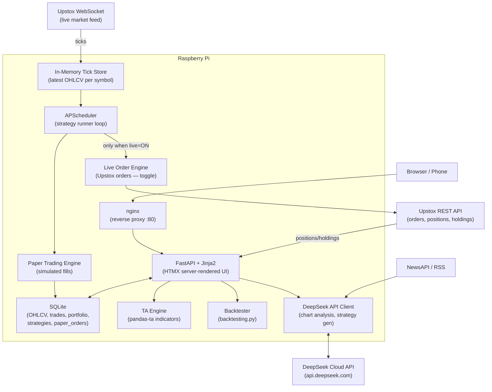

# AI-Assisted Trading App — Raspberry Pi (Revised)

## Confirmed Decisions

- **Broker**: Upstox (API v2 — free, modern REST + WebSocket, good Python SDK)
- **AI**: DeepSeek Cloud API (`deepseek-chat` for analysis/generation, `deepseek-reasoner` for complex strategy reasoning)
- **UI**: HTMX + Jinja2 templates (server-rendered, very light on Pi, no JS build toolchain)
- **Trading mode**: Paper trading always first — live order routing is a manually enabled toggle with risk gates
- **Automation**: Fully automated — algo evaluates signals and places orders without user confirmation

---

## Phase 0: Prerequisites

### Hardware

- Raspberry Pi 4 — **4 GB RAM minimum**, 8 GB preferred
- 32 GB+ microSD (A2 rated) or a USB SSD (much more reliable for a always-on server)
- Wired Ethernet — mandatory for a trading server; Wi-Fi is not reliable enough
- Raspberry Pi OS 64-bit (Bookworm)

### Accounts to Set Up

- **Upstox account** with API access enabled — go to [developer.upstox.com](https://developer.upstox.com), create an app, get your `api_key` and `api_secret`. Redirect URI should be `http://<pi-local-ip>:8000/auth/callback`.
- **DeepSeek account** — get an API key from [platform.deepseek.com](https://platform.deepseek.com). `deepseek-chat` (DeepSeek-V3) is extremely cheap (~$0.00027 per 1K input tokens — far cheaper than Claude or GPT).
- (Optional) **NewsAPI key** for news sentiment — [newsapi.org](https://newsapi.org) has a free tier.

### Python Environment on Pi

```
sudo apt update && sudo apt install python3.11 python3.11-venv python3-pip nginx -y
python3.11 -m venv ~/trading-env
source ~/trading-env/bin/activate
```

Key pip packages:

- `fastapi uvicorn[standard]` — backend server
- `jinja2 python-multipart` — templating + forms
- `upstox-python-sdk` — official Upstox SDK
- `pandas pandas-ta numpy` — data + indicators
- `sqlalchemy aiosqlite` — async SQLite ORM
- `apscheduler` — job scheduling for strategy runner
- `openai` — DeepSeek API client (DeepSeek is OpenAI-API-compatible, same SDK)
- `backtesting` — strategy backtester
- `httpx websockets` — HTTP client + WebSocket

---

## Architecture Overview




---

## Component Breakdown

### 1. Upstox Authentication

Upstox uses OAuth2 with PKCE. The flow:

1. App redirects you to Upstox login URL.
2. Upstox redirects back to `http://<pi-ip>:8000/auth/callback?code=...`
3. App exchanges code for `access_token` (valid 1 day).
4. Token is stored in SQLite and auto-refreshed each morning via APScheduler.

The `upstox-python-sdk` handles most of this. You'll set `UPSTOX_API_KEY`, `UPSTOX_API_SECRET`, and `UPSTOX_REDIRECT_URI` in a `.env` file.

### 2. Data Pipeline

- **Historical OHLCV**: On startup, fetch last N days of daily and intraday candles (1m, 5m, 15m) from Upstox Historical Data API and store in SQLite.
- **Live ticks**: Subscribe to Upstox Market Data WebSocket v2 (`wss://api.upstox.com/v2/feed/market-data-feed`). Feed ticks into `TickStore` (a Python dict keyed by instrument token). The WebSocket also produces OHLCV candles at each timeframe boundary — store these in SQLite.
- **Instrument master**: Download the full NSE/BSE instrument CSV from Upstox daily and store locally for symbol lookup.

### 3. Chart & TA Engine

- For any symbol + timeframe, read OHLCV from SQLite, compute indicators with `pandas-ta` (EMA 9/21/50, RSI 14, MACD, Bollinger Bands, ATR, VWAP, Supertrend).
- FastAPI route returns JSON data; Jinja template injects it into a **[Lightweight Charts](https://tradingview.github.io/lightweight-charts/)** canvas via a `<script>` block.
- HTMX polls `/chart/data?symbol=X&tf=5m` every 5 seconds during market hours to update the chart without a page reload.

### 4. Paper Trading Engine

This is the core safety layer. It sits between the strategy runner and real orders:

- Maintains a virtual account with configurable starting capital (e.g., ₹1,00,000).
- When a strategy fires a BUY signal: simulated fill at last tick price + a small slippage factor.
- Tracks paper positions, paper P&L, paper drawdown.
- All paper trades stored in `paper_orders` table in SQLite.
- A `LIVE_TRADING_ENABLED = False` flag in config routes all orders to paper engine. Setting it `True` (manual edit + server restart required) routes to live.

### 5. Strategy Engine

- Each strategy is a Python class inheriting `BaseStrategy`:
  - `name`, `symbols`, `timeframe`, `params` attributes
  - `on_tick(symbol, ohlcv_df, indicators_df) -> Signal` method returns `BUY / SELL / HOLD`
- APScheduler runs each strategy's `on_tick` every N seconds during market hours (9:15 AM – 3:30 PM IST).
- Built-in strategies to start with: **EMA Crossover**, **RSI Mean Reversion**, **Supertrend Breakout**.
- Strategies are stored as config in SQLite (name, params, enabled flag) — manageable from the UI.

### 6. Backtester

- Uses `backtesting.py` library.
- A FastAPI route accepts `(strategy_name, symbol, from_date, to_date, params)` and runs a backtest on stored OHLCV data.
- Returns metrics: total return %, Sharpe ratio, max drawdown, win rate, trade log.
- Results rendered in a Jinja template with an equity curve chart.
- **Mandatory gate**: A strategy must pass a minimum backtest threshold (configurable, e.g., Sharpe > 0.8, drawdown < 20%) before it can be enabled in the live/paper runner.

### 7. DeepSeek AI Integration

Three use cases, all using the `openai` Python SDK pointed at DeepSeek's base URL. DeepSeek's API is fully OpenAI-compatible — just swap `base_url` and `api_key`:

```python
from openai import OpenAI
client = OpenAI(api_key=DEEPSEEK_API_KEY, base_url="https://api.deepseek.com")
```

- **Chart Analysis**: Send last 50 candles + indicator values as a structured prompt. DeepSeek returns a markdown analysis: trend, key levels, signal suggestion, risk note. Model: `deepseek-chat` (DeepSeek-V3).
- **Strategy Generation**: User describes a strategy in plain English (e.g., *"buy when RSI crosses 30 from below and price is above 50 EMA"*). Use `deepseek-reasoner` (DeepSeek-R1) here — its chain-of-thought reasoning produces more correct and robust strategy code. You review it, save it, and backtest before enabling.
- **News Sentiment**: Fetch headlines for a symbol from NewsAPI, send to DeepSeek, get a bullish/bearish/neutral score with reasoning. Model: `deepseek-chat` (fast + extremely cheap — fractions of a rupee per call).

### 8. Portfolio & Risk Module

- **Paper portfolio**: virtual cash, paper positions, paper P&L — all from SQLite.
- **Live portfolio**: synced from Upstox `/portfolio/positions` and `/portfolio/holdings` API.
- **Risk rules** enforced by the strategy runner before every order:
  - Max capital per trade (e.g., 10% of portfolio)
  - Max open positions (e.g., 5 intraday)
  - Daily loss limit (e.g., stop all trading if down 2% on the day)
  - Auto square-off all intraday positions at 3:15 PM IST

### 9. Web UI — Pages


| Page              | Description                                                      |
| ----------------- | ---------------------------------------------------------------- |
| `/` Dashboard     | Market overview, active strategies, P&L summary, today's signals |
| `/chart/<symbol>` | Candlestick chart + indicators + Claude analysis button          |
| `/strategies`     | List strategies, enable/disable, edit params                     |
| `/backtest`       | Run a backtest, view results + equity curve                      |
| `/portfolio`      | Paper + live holdings, P&L, trade history                        |
| `/ai/chat`        | Chat with Claude about markets, strategies, risk                 |
| `/settings`       | Risk params, API keys, paper/live toggle                         |


All pages are server-rendered Jinja2 templates with HTMX for partial updates (no page reloads for data refresh).

---

## Tech Stack Summary

- **Backend**: Python 3.11, FastAPI, Jinja2, APScheduler, SQLAlchemy + aiosqlite (SQLite)
- **Broker**: Upstox API v2 + `upstox-python-sdk`
- **TA**: `pandas-ta` (pure Python, no C build issues on Pi)
- **Charts**: TradingView Lightweight Charts (CDN, no build step)
- **UI**: HTMX + Jinja2 templates + minimal CSS (Pico CSS or Tailwind CDN)
- **AI**: DeepSeek Cloud API — `deepseek-chat` (V3) for analysis/sentiment, `deepseek-reasoner` (R1) for strategy code generation
- **Backtest**: `backtesting.py`
- **Deployment**: `systemd` service + `nginx` reverse proxy on port 80

---

## Suggested Build Order

1. **Pi setup** — OS, Python env, nginx, `.env` file with secrets
2. **Upstox auth** — OAuth flow working, token stored, positions endpoint responding
3. **Project scaffold** — FastAPI app skeleton, SQLite schema, Jinja base template
4. **Instrument master + historical data fetch** — download NSE instrument list, fetch OHLCV into SQLite
5. **WebSocket tick feed** — subscribe to watchlist, populate TickStore, persist candles
6. **Chart UI** — `/chart/<symbol>` page with Lightweight Charts + HTMX auto-refresh
7. **TA indicators** — compute and overlay on chart
8. **Paper trading engine** — virtual account, simulated fills, paper P&L tracking
9. **Strategy engine** — `BaseStrategy`, EMA crossover starter strategy, APScheduler runner wired to paper engine
10. **Backtester** — run backtests, enforce pass gates before enabling strategies
11. **DeepSeek integration** — chart analysis (`deepseek-chat`), strategy code generation (`deepseek-reasoner`), news sentiment
12. **Portfolio dashboard** — paper + live sync, risk metrics, daily P&L
13. **Harden** — systemd auto-start, market-hours scheduler, daily loss limit auto-shutoff, auto square-off at 3:15 PM

---

## Important Notes on Upstox API

- Upstox requires **re-login every day** (access token expires in 24h). Automate this: either set up a headless browser login via `playwright` at 8:30 AM, or use the Upstox TOTP-based login flow with your TOTP secret stored securely on the Pi.
- The Upstox **WebSocket v2** uses protobuf encoding — the official SDK handles deserialization.
- **Rate limits**: Upstox allows 1000 API calls/minute. The strategy runner and data fetcher must respect this.
- Historical data via Upstox is limited; for deeper history (2+ years), supplement with `yfinance` for daily OHLCV.

