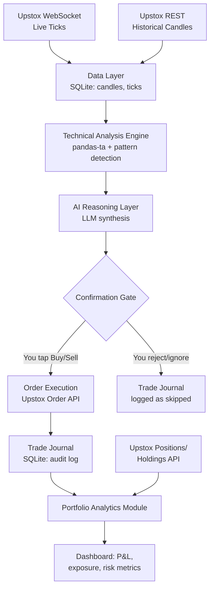

# Semi-Automated AI Trading System — Architecture Document

**Scope:** Personal-use intraday trading system for NSE/BSE, extending the existing Upstox/FastAPI algo trading project.
**Core principle:** AI analyzes and recommends with full reasoning shown; a human confirms every single order. No autonomous execution.

---

## 1. Design Principles

1. **Human-in-the-loop, always.** The system never places an order without an explicit tap/click from you. This is both the risk-management backbone and what keeps the system as a "regular API user" under SEBI's April 2026 algo framework rather than a registered algo (which requires manual confirmation of each order to stay out of scope).
2. **Explainability over black-box signals.** Every recommendation must show *which* indicators fired, *why* they triggered a signal, and the risk parameters — not just "BUY RELIANCE." This matters for trust (you're a beginner trader with strong engineering skills, not the reverse), and it keeps the strategy "white-box" in spirit even though an LLM is doing synthesis.
3. **Personal use only.** No multi-user, no sharing/selling strategies — keep it that way per SEBI's personal/family-use carve-out.
4. **Fail closed.** If market data is stale, the AI layer errors out, or confidence is low — no recommendation is surfaced. Silence is safer than a bad signal.

---

## 2. Current State → Additions

| Layer | Existing (assumed) | New / Extended |
|---|---|---|
| Data | Upstox API pull, SQLite | + WebSocket live tick stream, OHLCV candle store |
| Analysis | pandas-ta indicators | + pattern/S-R detection, multi-timeframe confluence |
| Scheduling | APScheduler | + event-driven triggers (price crosses, volume spikes) |
| Decision | — | + AI reasoning layer (new) |
| Execution | — (or manual) | + Confirmation gate → Upstox order API |
| Portfolio | — | + Positions/P&L/risk analytics module (new) |
| UI | HTMX | + Signal cards, confirm/reject buttons, portfolio dashboard |

*(Adjust this table once we look at your actual repo structure — flagging as an assumption for now.)*

---

## 3. High-Level Architecture



---

## 4. Component Deep-Dive

### 4.1 Data Ingestion Layer
- Upstox WebSocket for live intraday ticks (bind to your whitelisted static IP).
- REST polling fallback for historical candles (1m/5m/15m) to seed indicators on startup.
- Store raw ticks + resampled OHLCV candles in SQLite (or migrate to Postgres/TimescaleDB if tick volume grows — SQLite is fine for single-user intraday use).

### 4.2 Technical Analysis Engine
- pandas-ta for standard indicators: RSI, MACD, EMA/SMA crossovers, Bollinger Bands, ATR, VWAP.
- Custom pattern detection: support/resistance clustering (local minima/maxima), simple candlestick pattern flags (engulfing, doji, pin bar).
- Multi-timeframe confluence check (e.g., 5m signal only surfaced if 15m trend agrees) — reduces noisy intraday whipsaws.
- Runs on a schedule (APScheduler, e.g. every 1–5 min during market hours) or on tick-triggered events (price crosses a key level).

### 4.3 AI Reasoning & Strategy Layer
- Takes the technical snapshot (indicator values, price action, volume) as structured input — **not** raw chart images unless you specifically want vision-based chart reading.
- Calls an LLM (**DeepSeek** via OpenAI-compatible API — `deepseek-chat` for structured signals; keep `deepseek-reasoner` for strategy code generation) with a fixed system prompt defining its role: synthesize, don't invent — only reason over the indicators actually provided.
- Returns a **structured JSON contract** (see Section 6), never free text, so your backend can validate it and your UI can render it consistently.
- Confidence scoring: if the model isn't confident (conflicting indicators, low volume, choppy price action), it should say so explicitly rather than forcing a signal.

### 4.4 Confirmation Gate & Order Execution
- Recommendation surfaces in the UI as a card: instrument, direction, entry, stop-loss, target, reasoning, confidence.
- Two buttons only: **Confirm** / **Reject**. No auto-timeout auto-execute.
- On Confirm → order placed via Upstox order API, immediately logged to the trade journal with the AI's original reasoning attached (this becomes your audit trail and, later, your backtesting dataset).
- On Reject or no action within the signal's validity window → logged as skipped, also useful for later analysis ("how often do I override the AI, and was I right to?").

### 4.5 Portfolio Analytics Module
- Pulls live positions/holdings from Upstox.
- Computes: realized/unrealized P&L, per-stock and per-sector exposure, win rate, average R:R achieved vs. planned, max drawdown for the day.
- Fully decoupled from the signal-generation pipeline — read-only, so a bug here can never affect trading logic.

### 4.6 Trade Journal / Audit Log
- Every signal generated (confirmed, rejected, or expired) is logged with full reasoning, indicator snapshot, and outcome.
- This is your feedback loop: lets you (and eventually the AI layer, via few-shot examples of past reasoning) improve signal quality over time.
- Also doubles as your SEBI compliance record if ever asked to demonstrate the logic behind your trades.

---

## 5. Data Model (new tables)

```sql
-- Raw and resampled market data
CREATE TABLE candles (
    id INTEGER PRIMARY KEY,
    symbol TEXT NOT NULL,
    timeframe TEXT NOT NULL,       -- '1m', '5m', '15m'
    ts DATETIME NOT NULL,
    open REAL, high REAL, low REAL, close REAL, volume INTEGER
);

-- AI-generated signals
CREATE TABLE signals (
    id INTEGER PRIMARY KEY,
    symbol TEXT NOT NULL,
    generated_at DATETIME NOT NULL,
    direction TEXT NOT NULL,        -- 'BUY' / 'SELL'
    entry REAL, stop_loss REAL, target REAL,
    confidence REAL,                -- 0-1
    indicators_snapshot TEXT,       -- JSON blob
    reasoning TEXT,                 -- plain-English narrative
    status TEXT,                    -- 'pending', 'confirmed', 'rejected', 'expired'
    expires_at DATETIME
);

-- Executed / journaled trades
CREATE TABLE trade_journal (
    id INTEGER PRIMARY KEY,
    signal_id INTEGER REFERENCES signals(id),
    order_id TEXT,                  -- Upstox order ID, null if rejected
    action TEXT,                    -- 'confirmed', 'rejected', 'expired'
    executed_price REAL,
    outcome_pnl REAL,               -- filled in after position closes
    closed_at DATETIME
);
```

---

## 6. AI Output Contract

The LLM call should be constrained to return exactly this shape (validate on parse; discard/retry on schema mismatch):

```json
{
  "symbol": "RELIANCE",
  "direction": "BUY",
  "confidence": 0.72,
  "entry": 2945.5,
  "stop_loss": 2932.0,
  "target": 2971.0,
  "risk_reward_ratio": 2.0,
  "indicators_triggered": [
    "RSI(14) crossed above 30 from oversold",
    "Price reclaimed VWAP on rising volume",
    "15m trend confirms: EMA20 > EMA50"
  ],
  "reasoning": "Short paragraph explaining the setup in plain English",
  "invalidation": "What would prove this wrong (e.g., 'close below 2932 invalidates setup')"
}
```

The `invalidation` field is worth keeping even though you asked for confirm/reject only — it's what lets you sanity-check the AI's logic in three seconds before tapping Confirm.

---

## 7. Regulatory & Risk Guardrails (recap)

- Manual confirmation on every order keeps you outside SEBI's core "algo trading" definition (which centers on orders placed *without* manual confirmation).
- Even as a self-built, personal-use, white-box (transparent-logic) system, stay under 10 orders/second — trivially true here since a human is confirming each one.
- Personal/immediate-family use only; the strategy logic can't be shared or sold.
- Static IP whitelisting is now required broker-side (Upstox); confirm your API key is bound correctly.
- This is a summary, not legal advice — worth a final check against Upstox's current API/compliance docs before going live with real capital.

---

## 8. Tech Stack Summary

- **Backend:** FastAPI (existing), Python
- **DB:** SQLite (existing) — consider Postgres/TimescaleDB later if tick storage grows
- **Scheduling:** APScheduler (existing)
- **Technical analysis:** pandas-ta (existing)
- **Broker:** Upstox API (WebSocket + REST + Order API)
- **AI layer:** DeepSeek API (`deepseek-chat` structured JSON output mode) — not Claude
- **Frontend:** HTMX (existing) — signal cards, confirm/reject actions, portfolio dashboard

---

## 9. Phased Build Roadmap

1. **Phase 1 — Data + Analysis:** WebSocket tick ingestion, candle storage, indicator pipeline running and logging signals internally (no AI, no UI yet — just prove the pipeline works).
2. **Phase 2 — AI Reasoning Layer:** Wire indicator snapshots into the LLM call, validate structured output, log signals to the `signals` table.
3. **Phase 3 — Confirmation Gate + Execution:** UI signal cards, confirm/reject flow, wire Confirm to the Upstox order API, populate `trade_journal`.
4. **Phase 4 — Portfolio Analytics:** Positions/P&L dashboard, win-rate and R:R tracking off the journal data.
5. **Phase 5 — Feedback loop:** Use journaled outcomes to tune indicator thresholds or few-shot the AI layer with examples of good vs. bad past calls.

---

## 10. Open Questions to Confirm Against Your Actual Repo

- Current DB schema — does `candles`/similar already exist, or greenfield?
- Is Upstox WebSocket already integrated, or only REST polling so far?
- Preferred timeframe(s) for signal generation (1m/5m/15m)?
- Position sizing — fixed capital per trade, % of capital, or manual entry each time?
- Should rejected/expired signals also trigger a "why did I say no" prompt to build your own trading journal alongside the AI's?