# UI Documentation — AI Trading App (Site Map & Hierarchy)

**Stack context:** FastAPI + Jinja2 + HTMX (server-rendered, no JS build step), Lightweight Charts, DeepSeek AI (`deepseek-chat` for analysis/signals, `deepseek-reasoner` for strategy generation), Upstox API.
**Automation model:** Paper trading = fully automated (safe, simulated). Live trading = every order gated behind an explicit Confirm tap. Mode switch itself requires a config edit + restart (intentional friction, per your existing design) — the UI does not expose a live in-app toggle.

---

## 1. Navigation Philosophy

- **Safety-first hierarchy.** Signals — the one place real money decisions get made — gets its own top-level nav slot, not buried inside Dashboard.
- **Progressive disclosure.** Dashboard shows summaries only; every summary card links to its full page for depth (positions, journal, backtest detail).
- **Mode awareness everywhere.** A persistent header badge shows `PAPER` or `LIVE` at all times — color-coded (e.g., grey/blue for paper, red/amber for live) — so it's never ambiguous which mode is placing (simulated or real) orders.
- **Mobile-first nav:** bottom tab bar with 5 slots — Dashboard, Signals, Chart, Portfolio, More. Desktop: left sidebar with all 8 sections visible.

---

## 2. Site Map (Visual)

```mermaid
flowchart TD
    Root[AI Trading App]
    Root --> Dash[Dashboard /]
    Root --> Sig[Signals /signals]
    Root --> Chart[Chart & Analysis /chart/symbol]
    Root --> Strat[Strategies /strategies]
    Root --> Back[Backtest /backtest]
    Root --> Port[Portfolio /portfolio]
    Root --> AIChat[AI Chat /ai/chat]
    Root --> Set[Settings /settings]

    Dash --> D1[Market Overview]
    Dash --> D2[Active Strategies Widget]
    Dash --> D3[P&L Summary]
    Dash --> D4[Pending Signals Widget]
    Dash --> D5[Risk Status Banner]

    Sig --> S1[Pending Queue]
    Sig --> S2[History Log]
    Sig --> S3[Signal Detail Drilldown]

    Chart --> C1[Symbol Search/Switch]
    Chart --> C2[Candlestick + Indicators]
    Chart --> C3[AI Chart Analysis Panel]
    Chart --> C4[News Sentiment Panel]

    Strat --> ST1[Strategy List]
    Strat --> ST2[Strategy Detail/Edit]
    Strat --> ST3[New Strategy - Plain English Gen]

    Back --> B1[Config Form]
    Back --> B2[Results + Metrics]
    Back --> B3[Equity Curve]
    Back --> B4[Trade Log]

    Port --> P1[Overview Tab]
    Port --> P2[Positions Tab]
    Port --> P3[Trade Journal Tab]
    Port --> P4[Risk Metrics Tab]

    Set --> SE1[Risk Parameters]
    Set --> SE2[API Keys]
    Set --> SE3[Mode Status - read only]
    Set --> SE4[Watchlist Management]
```

---

## 3. Hierarchical Site Structure (Full Tree)

- **Dashboard** (`/`)
  - Market Overview widget (indices, watchlist mini-quotes)
  - Active Strategies widget (enabled strategies, live status dot)
  - P&L Summary widget (today's paper P&L, today's live P&L, side by side)
  - Pending Signals widget (top 3 pending, "View all →" to Signals)
  - Risk Status banner (daily loss limit progress bar, auto square-off countdown when near 3:15 PM)

- **Signals** (`/signals`) — *the confirmation gate*
  - Pending tab
    - Signal Card (per instrument): direction, entry, stop-loss, target, R:R, confidence, indicators triggered, reasoning, invalidation condition
    - Confirm button → mode-aware behavior:
      - Paper: instant simulated fill, toast confirmation
      - Live: secondary "Place BUY order for ₹X qty at ~₹Y — confirm?" dialog before hitting Upstox
    - Reject button → optional 1-tap reason (wrong setup / bad timing / overridden by news / other)
    - Countdown to expiry per signal
  - History tab
    - Filterable log: confirmed / rejected / expired, by date/symbol/strategy
  - Signal Detail (drilldown from either tab)
    - Full indicator snapshot at generation time
    - Linked outcome (if confirmed): executed price, current/closed P&L

- **Chart & Analysis** (`/chart/<symbol>`)
  - Symbol search/switch (from instrument master)
  - Timeframe selector (1m / 5m / 15m / daily)
  - Candlestick chart (Lightweight Charts) with indicator overlays (EMA 9/21/50, RSI, MACD, BB, ATR, VWAP, Supertrend — toggle each)
  - AI Chart Analysis panel — button triggers `deepseek-chat` structured analysis (trend, key levels, signal suggestion, risk note)
  - News Sentiment panel — headlines for symbol + bullish/bearish/neutral score with reasoning
  - "Generate Signal" action — sends current chart context into the same signal pipeline that feeds `/signals`

- **Strategies** (`/strategies`)
  - Strategy List — table: name, symbols, timeframe, enabled toggle, backtest-pass badge (✅/❌)
  - Strategy Detail/Edit — params form, enable/disable, view backtest history for this strategy
  - New Strategy — Plain English generator
    - Text input: describe the strategy in plain English
    - `deepseek-reasoner` generates strategy code
    - Code review step (read-only diff view) — must be reviewed before saving
    - "Send to Backtest" action (cannot enable live/paper runner without passing the backtest gate)

- **Backtest** (`/backtest`)
  - Configuration form: strategy, symbol, date range, params override
  - Results panel: total return %, Sharpe ratio, max drawdown, win rate
  - Equity curve chart
  - Trade log table (entry/exit, P&L per trade)
  - Pass/Fail gate indicator (Sharpe/drawdown thresholds) — blocks "Enable" on Strategies page if failed

- **Portfolio** (`/portfolio`)
  - Overview tab — paper P&L, live P&L, combined exposure by sector/stock
  - Positions tab — open positions (paper + live, clearly separated), per-position unrealized P&L
  - Trade Journal tab — full audit log: every signal (confirmed/rejected/expired) with reasoning attached, outcome P&L once closed
  - Risk Metrics tab — win rate, average R:R achieved vs. planned, max daily drawdown, override rate (how often you reject AI signals)

- **AI Chat** (`/ai/chat`)
  - Freeform conversation with the AI about markets, open positions, or strategy ideas
  - Context-aware: can reference current watchlist/positions if asked

- **Settings** (`/settings`)
  - Risk Parameters — max capital per trade, max open positions, daily loss limit %, auto square-off time
  - API Keys — Upstox key/secret status, DeepSeek key status, NewsAPI key status (masked, with "test connection" action)
  - Mode Status — read-only display of current `LIVE_TRADING_ENABLED` value, with a note on how to change it (config edit + restart), preserving your intentional friction
  - Watchlist Management — add/remove symbols from the instrument master list used across Dashboard/Chart

---

## 4. Cross-Cutting UI Patterns

- **Signal Card** — the single most reused component (Dashboard widget, Signals page, Chart page "Generate Signal" result). Same layout everywhere so it's instantly recognizable.
- **Mode-aware Confirm** — Confirm button behavior branches on Paper vs Live; Live always gets one extra confirmation step. Never let Live silently mirror Paper's single-tap flow.
- **Empty/Loading/Error states** — every data panel (chart, signals, journal, backtest results) needs explicit empty ("no signals yet today"), loading (HTMX spinner), and error (stale data / API failure) states — silent blank panels are the main way a beginner trader misreads "nothing happening" as "everything's fine."
- **Risk gate banners** — daily loss limit and auto square-off aren't just Settings values; surface them as a persistent banner once a threshold is approaching (e.g., "80% of daily loss limit used" or "Auto square-off in 12 min").

---

## 5. Open Items

- Confirm the automation-discrepancy question above before this ships as final.
- Should the Signal Card's "Reject reason" feed back into strategy tuning, or stay purely observational for now?
- Any preference on where Watchlist Management lives — Settings (as drafted) or its own nav item if the list grows large/frequently edited?